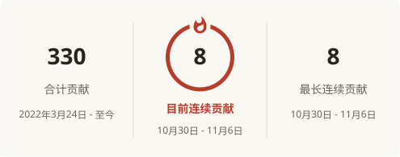

<picture>
  <source media="(prefers-color-scheme: dark)" srcset="assets/brand/bole-lockup-clean-dark.svg">
  
</picture>

游戏 · 工具 · 实验

做游戏，也做一些有趣的小东西。

中文 · <a href="README_en.md">English</a>

我是伯乐，一名 Unity 前端开发工程师。主要使用 Unity / C#，也会用 Blender 和相关工具做些创作。

这里放着我的游戏作品、网页小工具和还在探索的想法。

喜欢玩游戏，也喜欢读科幻小说，最喜欢的是《三体》。

<a href="https://space.bilibili.com/91449410"><picture>
  <source media="(prefers-color-scheme: dark)" srcset="assets/icons/bilibili-dark.svg">
  
</picture> B 站</a>
 ·
<a href="https://github.com/H-Bole"><picture>
  <source media="(prefers-color-scheme: dark)" srcset="assets/icons/github-dark.svg">
  
</picture> GitHub</a>

## 精选作品

### AI 角色参考与合成工作台

基于 [Anhao 中文版](https://github.com/anhao/ai-pose-gallery-zh)二次开发，把姿势、服装和人像参考放在一起，支持角色合成、工作流参数调整和参考图上传。**本地生成需要连接本机 ComfyUI。**

[打开合成台](https://h-bole-ai-pose-gallery.ai-pose-gallery-zh.workers.dev/studio) · [查看仓库](https://github.com/H-Bole/ai-pose-gallery-zh)

### 灯影刘肉丝电影评级档案

把电影评级整理成可搜索、可筛选的档案，保留每次评级的修订记录，方便找片，也方便回看。

[浏览档案](https://h-bole.github.io/dengying-rating-archive/) · [查看仓库](https://github.com/H-Bole/dengying-rating-archive)

### Boom_VR

以前做的一款 Unity VR 作品，保留了作品介绍和体验包。公开仓库不包含源码。

[查看作品](https://github.com/H-Bole/Boom_VR) · [下载体验包](https://github.com/H-Bole/Boom_VR/releases/latest)

## 在线逛逛

| 站点 | 这里有什么 |
| --- | --- |
| [作品与 Unity 资源](https://h-bole.github.io/H-Bole.io/) | 作品展示与 Unity 资源入口 |
| [电影评级档案](https://h-bole.github.io/dengying-rating-archive/) | 搜索电影、查看评级与修订记录 |
| [AI 角色合成工作台](https://h-bole-ai-pose-gallery.ai-pose-gallery-zh.workers.dev/studio) | 角色参考与合成，支持本地 ComfyUI |
| [TIDAL · 水与想象](https://h-bole.github.io/tidal-lab/) | 水体与云海的视觉实验 |

## 最近在探索

- **ComfyUI / AI 绘图**：尝试角色参考、姿势与服装搭配，摸索不同的图像生成工作流。
- **AI 视频**：试着让画面动起来，探索从图像到短片的可能。
- **Vibe Coding / 游戏**：用 AI 辅助编程，把游戏点子做成能玩的原型，边做边学。

## GitHub 足迹

<picture>
<source media="(prefers-color-scheme: dark)" srcset="https://raw.githubusercontent.com/H-Bole/H-Bole/output/stats-zh-dark.svg">

</picture>

<picture>
<source media="(prefers-color-scheme: dark)" srcset="https://raw.githubusercontent.com/H-Bole/H-Bole/output/snake-dark.svg">

</picture>
