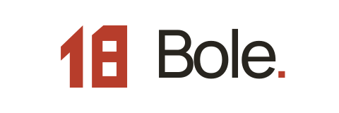
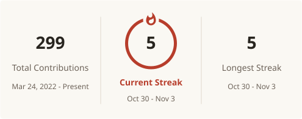

<picture>
  <source media="(prefers-color-scheme: dark)" srcset="assets/brand/bole-lockup-clean-dark.svg">
  
</picture>

Games · Tools · Experiments

Making games, and a few things just for fun.

<a href="README.md">中文</a> · English

I'm Bole, a Unity developer focused on client-side development. I mainly work with Unity and C#, and use Blender and other tools for creative projects.

This is where I share my games, small web tools, and ideas I'm still exploring.

I enjoy playing games and reading science fiction. My favorite is *The Three-Body Problem*.

<a href="https://space.bilibili.com/91449410"><picture>
  <source media="(prefers-color-scheme: dark)" srcset="assets/icons/bilibili-dark.svg">
  
</picture> Bilibili</a>
 ·
<a href="https://github.com/H-Bole"><picture>
  <source media="(prefers-color-scheme: dark)" srcset="assets/icons/github-dark.svg">
  
</picture> GitHub</a>

## Selected work

### AI Character Reference & Composition Studio

My customized fork of [Anhao's Chinese edition](https://github.com/anhao/ai-pose-gallery-zh), bringing pose, clothing, and portrait references together with character composition, workflow settings, and reference-image uploads. **Local generation requires ComfyUI running on your own machine.**

[Open studio](https://h-bole-ai-pose-gallery.ai-pose-gallery-zh.workers.dev/studio) · [Repository](https://github.com/H-Bole/ai-pose-gallery-zh)

### Dengying Liurousi Film Rating Archive

A searchable, filterable film rating archive with revision history. Find a film or look back at how its rating has changed.

[Browse archive](https://h-bole.github.io/dengying-rating-archive/) · [Repository](https://github.com/H-Bole/dengying-rating-archive)

### Boom_VR

An earlier Unity VR project, with a project overview and a downloadable build. The public repository does not include source code.

[Project overview](https://github.com/H-Bole/Boom_VR) · [Download build](https://github.com/H-Bole/Boom_VR/releases/latest)

## Around the web

| Site | What you'll find |
| --- | --- |
| [Portfolio & Unity resources](https://h-bole.github.io/H-Bole.io/) | Creative work and Unity resources |
| [Film Rating Archive](https://h-bole.github.io/dengying-rating-archive/) | Films, ratings, and revision history |
| [AI Character Studio](https://h-bole-ai-pose-gallery.ai-pose-gallery-zh.workers.dev/studio) | Character references and composition with local ComfyUI support |
| [TIDAL · Water & Imagination](https://h-bole.github.io/tidal-lab/) | Visual experiments with water and seas of clouds |

## Currently exploring

- **ComfyUI / AI images** — Experimenting with character references, poses, clothing, and image-generation workflows.
- **AI video** — Bringing images into motion and exploring how they can become short videos.
- **Vibe coding / games** — Using AI-assisted coding to turn game ideas into playable prototypes, learning as I go.

## GitHub activity

<picture>
<source media="(prefers-color-scheme: dark)" srcset="https://raw.githubusercontent.com/H-Bole/H-Bole/output/stats-en-dark.svg">

</picture>

<picture>
<source media="(prefers-color-scheme: dark)" srcset="https://raw.githubusercontent.com/H-Bole/H-Bole/output/snake-dark.svg">

</picture>
